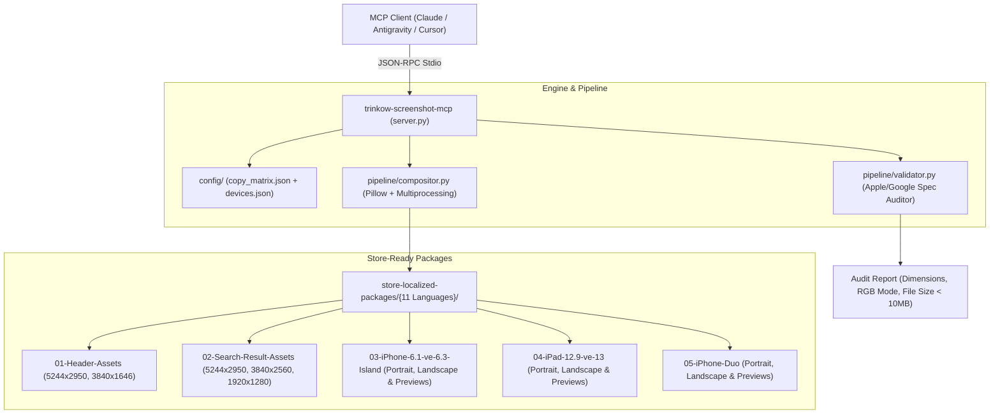

# Trinkow Store Screenshot MCP Server (`trinkow-screenshot-mcp`)

A high-performance Model Context Protocol (MCP) server designed for automating **multi-language App Store & Google Play screenshot generation**, compositing, and verification.

---

## 🎯 Architecture Overview



---

## 🌍 Supported Locales (11 Languages)

| Code | Language | Native Name | Currency | Tagline |
| :--- | :--- | :--- | :---: | :--- |
| `tr` | Turkish | Türkçe | ₺ TRY | Evdeki Hesabı Çarşıya Uydurur |
| `en` | English | English | \$ USD | Make your money work for you |
| `de` | German | Deutsch | € EUR | Damit deine Rechnung aufgeht |
| `fr` | French | Français | € EUR | Le budget qui colle à la réalité |
| `es` | Spanish | Español | € EUR | Hace que tus cuentas cuadren |
| `it` | Italian | Italiano | € EUR | Fa quadrare i conti |
| `cs` | Czech | Čeština | Kč CZK | Rozpočet, který vyjde i v obchodě |
| `pt` | Portuguese | Português | € EUR | Põe as contas de casa a bater certo |
| `ru` | Russian | Русский | ₽ RUB | Сводит планы с реальностью |
| `ro` | Romanian | Română | lei RON | Potrivește socoteala de acasă cu cea din târg |
| `pl` | Polish | Polski | zł PLN | Budżet, który zgadza się z życiem |

---

## 🛠️ MCP Tools Exposed

1. **`list_supported_locales`**: Inspects available languages, ISO codes, currencies, and taglines.
2. **`get_device_matrix`**: Returns the exact resolution, aspect ratio, and layout rules for Header, Search Results, iPhone 6.1"/6.3", iPad 12.9"/13", and iPhone Duo.
3. **`render_localized_bundle`**: Multi-core batch rendering engine with background caching and dynamic typography fitting (zero text clipping across German, Russian, and all diacritics).
4. **`validate_store_bundle`**: Validates pixel dimension exactness, RGB profile, file size limits (<10MB), and missing files.

---

## 🚀 Setup & Configuration

Add this entry to your MCP client config (e.g., `claude_desktop_config.json` or Antigravity MCP settings):

```json
{
  "mcpServers": {
    "trinkow-screenshot-mcp": {
      "command": "python3",
      "args": [
        "/Users/mustafa/Desktop/cod/trinkow-mobile/tools/trinkow-screenshot-mcp/server.py"
      ],
      "env": {
        "PYTHONPATH": "/Users/mustafa/Desktop/cod/trinkow-mobile/tools/trinkow-screenshot-mcp"
      }
    }
  }
}
```

### CLI Direct Execution

```bash
# Render all 11 languages (1,331 assets in ~1 minute)
PYTHONPATH=tools/trinkow-screenshot-mcp python3 tools/trinkow-screenshot-mcp/pipeline/generator.py

# Render specific languages
PYTHONPATH=tools/trinkow-screenshot-mcp python3 tools/trinkow-screenshot-mcp/pipeline/generator.py en,de,tr

# Validate generated package
PYTHONPATH=tools/trinkow-screenshot-mcp python3 tools/trinkow-screenshot-mcp/pipeline/validator.py
```

